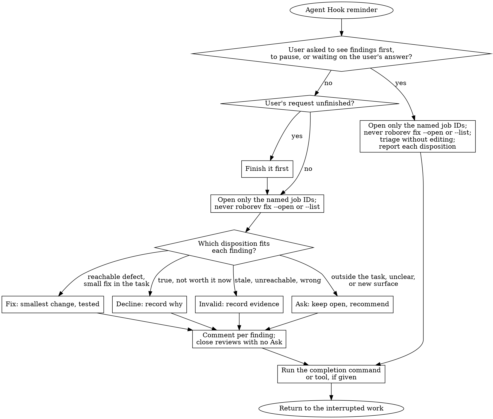

`roborev agent hook` connects roborev's asynchronous reviews to coding-agent
harness hooks. It records shell-tool and stop events, checks for open failed
reviews, and reminds the active agent to fix them before the session goes cold.

Run `roborev agent setup [--mcp]` to connect Claude Code and Codex. If Codex
asks for review, run `/hooks` in Codex, then `roborev agent setup --check`.

The integration supports every profile in
[`go.kenn.io/kit/agenthook`](https://pkg.go.dev/go.kenn.io/kit/agenthook):

- Claude Code
- Codex
- GitHub Copilot CLI
- Cursor
- Factory Droid
- Gemini CLI
- Hermes Agent
- Qwen Code

Kit owns each harness's native config format, event names, command quoting,
payload normalization, and response encoding. Roborev owns only installed-agent
selection, reminder policy, and local session state.

!!! note

    This differs from [Review Hooks](/docs/guides/hooks/), which run your own shell
    commands when a review completes. Agent Hook plugs into the coding agent's hook
    system to steer the active session itself.

## The Loop

Agent Hook tracks three signals per session:

- **Turns:** `Stop` events, for periodic repair during long sessions.
- **Commits:** normalized shell `PreToolUse` and `PostToolUse` events. Kit maps
    each harness's native shell tool to the common `Bash` vocabulary. Claude
    also records commit commands through `PostToolUseFailure` when a later
    command in the same call fails.
- **Failed reviews:** open, non-closed roborev reviews of commits this session
    gained during `git commit`, `git cherry-pick`, or `git revert`, including
    amends and batched reviews whose range contains one of those commits.
    Reviews of uncommitted changes do not count. Design reviews do not count.
    They grade a written design, so the agent fixing the code usually cannot
    resolve their findings. To stop reviews whose findings are all low from
    failing, and so from counting, set
    [`review_min_severity`](configuration.md#per-repository-options) to `medium`.

Existing sessions start collecting newly observed commits after an upgrade.

Roborev scopes commit and failed-review accounting to repository lineage, so
activity in one worktree does not consume another worktree's reminder. Older
failed reviews, compacted reviews, and reviews moved by a rebase remain
available in the TUI and `/roborev-fix`. Outside a tracked git repository the
hook returns an empty native response.

Agents that roborev launches for reviews, synthesis, and fixes run with
`ROBOREV_AGENT_HOOK_SUPPRESS=1`. The hook returns an empty native response in
those sessions, so a review agent is never asked to triage roborev's own
reviews. This relies on the harness passing its environment to hook commands.

### Review guidelines are required

Agent Hook never sends a reminder in a repository that has no review guidance of
its own. The daemon reads the same repository guidance that reviews use:
`review_guidelines` in `.roborev.toml` on the default branch, or a root
`REVIEW.md` when `review_guidelines` is unset. Global `review_guidelines` in
`~/.roborev/config.toml` do not count, because they are not tuned to the
repository. Without guidance, the hook behaves as if the checkout were
[snoozed](#snoozing-reminders): baselines advance, reminders never build up, and
adding guidance later does not cause a burst of catch-up reminders.

If the default branch has no `.roborev.toml`, guideline loading falls back to
the working tree's file. This lets a repository keep local review guidance
without committing it to the default branch.

The rule exists because the agent fixes what the reviewer flags. A reviewer
without project guidance flags generic concerns, such as defensive checks, extra
abstraction, and unlikely edge cases, and a hook-driven agent that fixes all of
them overengineers the code. Guidance alone does not prevent this; tune it on
real reviews before relying on the hook. See
[Review Guidelines](configuration.md#review-guidelines) for the options.

Every reminder opens with a fixed preamble. It says the reminder is background
maintenance, that the user's latest instruction comes first, and that findings
are a reviewer's suggestions to triage, not requirements.

### Triage diagram

The default instruction names the exact review job IDs and asks the agent to
triage them with the `roborev-fix` skill. Unless a custom instruction replaces
it, new Stop, commit, failed-review, deferred, and injected reminders include
the following triage flow:



Stop, commit, failed-review, and deferred reminders put their trigger counts and
review job IDs after the flow. UserPromptSubmit and SessionStart injections put
the failed-review facts before the preamble and flow. An active fix-session
continuation repeats its saved review job IDs and completion command without
repeating the flow. The built-in flow never runs `roborev fix --open` or
discovers additional reviews. It gives each finding one disposition:

- **Fix:** a reachable defect with real harm, removable by a small change inside
    the current task.
- **Decline:** true, but not worth its cost now, such as hardening for paths
    nothing reaches. The agent records why.
- **Invalid:** stale, already resolved, unreachable, or wrong. The agent records
    the evidence.
- **Ask:** outside the current task, unclear in scope, or a fix that adds new
    surface such as an endpoint, schema, or config option.

A review closes when every finding is Fix, Decline, or Invalid. A review with an
Ask finding stays open until the user gives direction. The skill weighs cost
because a reviewer looks for gaps without weighing what a fix costs. An agent
that fixes every true finding overbuilds the code.

Delivered review IDs are acknowledged in the Agent Hook daemon's session state,
scoped to the repository lineage. They do not trigger another reminder in that
session, while newly created review IDs still do. Deferred reminders acknowledge
their IDs only when delivered.

An empty `instruction` uses the built-in workflow. So does a saved copy of any
earlier built-in instruction: older versions wrote the default into
`config.toml`. Custom text still replaces the workflow.

`instruction` replaces the default instruction, diagram included, but not the
preamble. A reminder separates the preamble, instruction, and trigger facts with
blank lines. When it starts a fix session, roborev adds the completion command
after those facts.

### Coordinating hook-triggered fixes

Agent Hook allows one active fix session for each physical worktree. The daemon
records the owner as the agent profile and harness session ID when it delivers a
reminder. Other sessions receive no duplicate fix instruction while that owner
remains active. The ownership follows that worktree across branch switches and
detached HEAD transitions. Separate worktrees remain independent.

Each delivered instruction includes its exact completion command. The preferred
spelling is:

```bash
roborev agent hook fix-done [--roborev-server <address>] <fix-session-id>
```

Existing hooks may emit the compatible `roborev agent-hook fix-done` spelling.
Run the exact command the instruction provides.

When the hook uses `--roborev-server` or `ROBOREV_AGENT_HOOK_ROBOREV_ADDR`, the
emitted command includes the resolved address. Completion therefore reaches the
daemon that granted ownership rather than the daemon found through runtime
discovery.

The bundled `roborev-fix` skill runs that command after its final review audit,
including when no code changed or an Ask finding remains open. The command
releases ownership immediately. Repeating it for the same current fix session is
safe, while an old ID cannot release a newer owner.

If the owner reaches a normal `Stop` event before completion, Agent Hook blocks
with a reminder naming the original review job IDs and the same completion
command. The IDs are saved with the fix session and survive daemon restarts; new
reviews do not expand an active session. For sessions created before this state
included review IDs, the skill uses the original IDs from conversation context.
Recursive Stop events remain skipped. Ownership also expires 12 hours after
delivery. Hook activity does not extend that fixed period.

This coordination applies only to Agent Hook reminders. Direct human invocations
of `roborev fix` or the `roborev-fix` skill do not create or check a fix
session.

When a reminder triggers for a supported agent, the hook compares that agent's
installed `roborev-fix` skill with the version embedded in the running roborev
binary. If the skill is missing or outdated, the reminder begins with a warning
to run `roborev agent skills install`. The original instruction and its exact
review job IDs are still delivered. The hook never updates skills automatically.

## Install

Install hooks for every locally detected coding agent:

```bash
roborev agent hook install
```

An agent is detected when its executable is on `PATH` or its config directory
already exists. The executable candidates are `claude`, `codex`, `copilot`,
`agent` (Cursor), `droid`, `gemini`, `hermes`, `qwen`, `grok`, and `zcode`.

Select one profile or deliberately install all ten integrations (the eight kit
profiles plus Grok Build and ZCode):

```bash
roborev agent hook install --agent qwen
roborev agent hook install --agent all
```

Use one uniform config override when selecting exactly one agent:

```bash
roborev agent hook install --agent hermes --config ~/.hermes/config.yaml
```

Automatic and `all` installs attempt every selected profile and report all
errors after preserving successful installs. `--dry-run` plans the same changes
without writing.

For every supported agent, installation also creates or updates that profile's
bundled roborev skills before activating the hook. Pass `--mcp` to install MCP
configuration and MCP skill instructions together. The default transport is
stdio; use `--mcp-transport http --mcp-url <daemon URL>/mcp` for an existing
daemon endpoint. See [MCP setup](integrations/mcp.md).

Factory Droid remains user-scoped. Roborev rejects project `.factory/hooks.json`
paths because they are executable repository-local configuration.

ZCode's prompt-only events establish no commit ownership, so its reminders stay
silent. See [ZCode](#zcode) for its installation details and diagnostics. All
profiles require
[repository review guidelines](#review-guidelines-are-required).

Agent Hook uses the same stable binary resolver as `roborev init`. Pin a shim or
binary explicitly when needed:

```bash
roborev agent hook install --binary ~/.local/share/mise/shims/roborev
```

For configs synced across machines, `--binary roborev` or `--binary roborev.exe`
checks the name on PATH and keeps the bare name in generated hooks. The harness
must have roborev on its runtime PATH. With `--mcp`, the stdio server entry uses
the same name. Other bare names and paths are saved as absolute paths.

On Windows, generated Claude Code hook commands use Git Bash-compatible quoting,
including for Scoop installation paths.

`--command` supplies one complete command for an explicit profile. It must
directly invoke `agent-hook run` and select exactly one matching `--agent`;
shell pipelines, chaining, command substitutions, and wrappers are rejected.
Roborev adds its ownership marker before installation. `--command` cannot be
combined with `--binary`.

### After upgrading

Check the version selected by the configured hook command, not just the version
of a newly downloaded binary. Version-manager shims may still select an older
installation. Check the running daemon's version through `/api/status` too.

Run `roborev agent hook install --agent <profile> --dry-run` using the intended
installed binary and the existing `--config`, `--binary`, and MCP options. Then
repeat without `--dry-run` to refresh the registration and bundled skills.
`roborev agent skills install` updates only skills. Reinstalling a hook that
uses a shim does not change the version selected by that shim.

A daemon restart is a separate operation. Agents must follow local approval
rules before restarting an existing daemon. `roborev daemon status` can
automatically replace an outdated daemon in a supported systemd user service.
Responsive daemons in unsupported service modes stay in use with a manual
restart command; follow local approval rules before running it.

### ZCode

Install the ZCode hook and bundled skills:

```bash
roborev agent hook install --agent zcode
```

Automatic installation also detects `zcode` on `PATH` or its existing
`~/.zcode/cli/` directory. Update and restart the daemon before installing; an
older daemon may skip events it does not recognize.

The installer registers a plugin under `~/.roborev/zcode-plugin/` in
`plugins.dirs` in `~/.zcode/cli/config.json`. It also installs bundled skills
under `~/.zcode/skills/`. Add `--mcp` to install MCP configuration too.

Reminders arrive as additional session context. Each names the repository,
review jobs, commits, and verdicts, and tells the agent how to handle them. The
usual reminder thresholds, acknowledgments, and
[review-guideline requirement](#review-guidelines-are-required) apply.

The tested ZCode versions dispatch only `SessionStart` and `UserPromptSubmit`.
Those events establish no commit ownership, so reminders stay silent. Reviews
remain available through `/roborev-fix` and the TUI. A Stop registration stays
installed for versions that dispatch shell events and stops.

`--stop-form` replaces the `SessionStart` and `UserPromptSubmit` registrations
with `Stop`, `PreToolUse`, and `PostToolUse`. Use it only with a ZCode version
that dispatches those events; on the tested versions it disables reminders. Both
forms share the same thresholds and acknowledgment state. Registrations allow at
least 30 seconds because an observed run took 15 seconds from start to finish.

If no reminder arrives, inspect ZCode's hook execution log. Roborev writes the
repository, branch, failed-review counts, and threshold to the hook's error
stream. It also reports reasons such as `review guidelines missing`, so you can
distinguish a muted reminder from a failed query.

## Declarative Config

`dump` requires one profile and writes the complete planned native config to
stdout without modifying the file:

```bash
roborev agent hook dump --agent codex
roborev agent hook dump --agent qwen
roborev agent hook dump --agent hermes
```

JSON-backed harnesses produce JSON. Hermes produces YAML. Use `--config` to
merge an existing file into the plan. Binary-resolution diagnostics stay on
stderr so stdout remains safe to pipe into declarative configuration tooling.

## Runtime Model

Installers keep the compatible `agent-hook run` spelling. Installed commands
identify their profile and carry an internal ownership marker:

```bash
roborev agent-hook run --agent <profile>
```

`run` rejects commands without the installed ownership marker. If this happens,
edit the agent's hook config and remove the `roborev agent-hook run` command
that does not contain `--source=roborev-agent-hook`. Then run
`roborev agent hook install`. The installer does not keep rules for recognizing
or removing old registrations.

Current commands require `--agent`, read one finite native hook payload from
stdin, pass it through kit's typed dispatcher, post a normalized request to the
regular roborev daemon, and let kit encode the native response.

The regular daemon loads and persists session accounting and delivered review
IDs at:

```text
${ROBOREV_DATA_DIR:-~/.roborev}/agent-hook/state.json
```

Sessions idle for 30 days, including their queued reminders, are dropped when
the daemon loads or saves state. Resuming a dropped session starts its counts
and acknowledged reviews fresh, so it can receive reminders again about reviews
still open and failed.

The same process reads repository registration, review jobs, verdicts, and
workspace snoozes from the review database. Hook communication fails open: a
diagnostic goes to stderr and the harness receives an empty native response.
Invalid native payloads or unsupported profile names remain normal CLI errors.
If the JSON snapshot is unreadable, only Agent Hook event, status, and reset
operations are unavailable; review and queue APIs continue to run, and roborev
does not overwrite the unreadable file. Repair or remove the file, then restart
the regular daemon to load it again.

Persisting reminder state is the at-most-once delivery boundary. Cancellation
observed before that commit leaves a reminder queued; a disconnect after the
commit can consume it because coding-agent hook protocols do not acknowledge
receipt.

### Hermes

Hermes observes post-tool events but cannot inject control output there. When a
post-tool threshold fires, roborev queues a reminder by repository lineage and
trigger type. The next Hermes `Stop` delivers one reminder, ordered by failed
reviews before commits and then creation time. Hermes acquires fix-session
ownership only when that Stop event delivers the reminder.

Queued reminders retain the absolute triggering worktree and tell the agent to
change to it before running review commands, even if the session changed
directories or used `git -C`. Delivery waits until that worktree is back on the
triggering branch, or the exact triggering commit for a detached checkout, so
the fallback commands query the intended lineage. Repeated triggers coalesce
without losing their original queue position. Failed-review reminders are
rechecked before delivery and discarded if the reviews have been resolved.
Commit reminders receive the same recheck, so no queued reminder is delivered
after its failed reviews are resolved.

### Cursor

Cursor sends the same normalized events, thresholds, and accounting requests as
every other profile. Kit v0.14.0 cannot encode control output for Cursor's
post-tool or stop boundaries, so roborev always emits an empty Cursor response.
Because Cursor cannot receive the fix or completion instructions, its events do
not acquire fix-session ownership.

## Snoozing Reminders

Silence Agent Hook reminders temporarily when a session needs a longer stretch
of implementation work:

```bash
roborev agent hook snooze                 # defaults to eight hours
roborev agent hook snooze on --duration 2h
roborev agent hook snooze off             # resume immediately
```

The snooze is scoped to the current linked worktree and branch. Switching
branches or working in another checkout does not inherit it. Reviews continue to
enqueue and failed reviews keep accumulating; only the coding-agent reminder is
muted. Hook baselines advance while snoozed, avoiding a catch-up reminder for
every commit made during the quiet period.

Run `roborev daemon status` to list every active snooze with its exact
repository, worktree, branch, and expiry. When the TUI is launched from a
snoozed checkout with automatic repository and branch filters enabled, its title
shows the snooze deadline. Clearing or changing either filter hides the badge
because the view no longer identifies that exact snooze scope.

The bundled `/roborev-snooze` skill (or `$roborev-snooze` in Codex) exposes both
the `on` and `off` operations from an agent session.

## Configuration

Set the top-level global `fix_guidelines` value when agents should validate
review suggestions against a standing policy before editing:

```toml
fix_guidelines = """
Treat review findings as hypotheses. Verify each one against the code and
project requirements. Explain findings that are intentionally not applied.
"""
```

Roborev appends this policy to triggered reminders after the profile's complete
instruction and continuation text. It also reaches direct, batch, and
commit-retry prompts from foreground `roborev fix`. An empty value keeps the
current automatic behavior unchanged.

`fix_guidelines` belongs only in the standard global config. It is separate from
the profile `instruction`, which remains a full replacement for workflow text.
If `agent-hook run --config` selects another file for thresholds or instruction,
fix guidelines still come from the standard global config.

### Repository review flow

A repository can set `[agent_hook] review_flow` in `.roborev.toml` to a bare DOT
digraph describing how to handle its review findings. Follow the
[DOT flow conventions](#dot-flow-conventions). The setup-review skill writes one
from its interview when a coding agent handles automatic review findings.

#### DOT flow conventions

When the hook appends a flow to a reminder, it wraps the bare
`digraph roborev_<name>` in a `~~~dot` fence. The first statement is
`node [shape=box];`. Declare nodes before their edges. An oval marks the entry
or an exit; a diamond asks a question and has labeled outgoing edges. Actions
use boxes with at most one outgoing edge. Every node must be reachable from the
single entry.

Use lowercase snake case node IDs and double-quoted labels. Write line breaks as
`\n`, keep commands verbatim, and put changing values outside the graph.
Subgraphs, HTML labels, templates, and escaped quotes are outside this subset.

The hook appends this flow after the trigger facts and any triggering-worktree
sentence, and before the completion command, MCP hints, and fix guidelines. It
refines the built-in triage diagram's Which disposition step and ends by handing
back to `roborev_triage`. A custom `instruction` suppresses repository flows for
that profile, including a custom `droid_hook.instruction` for Droid. Fix-session
continuations do not repeat the flow.

Like review guidelines, the flow comes from `.roborev.toml` on the default
branch. The working tree is used only when that branch has no config or no
default branch resolves. A feature branch cannot change it while the default
branch has a config. Invalid trusted config never falls back to working-tree
text; the reminder continues without a repository flow.

`roborev config validate` checks the supported DOT grammar and rejects fenced
text or the reserved graph name `roborev_triage`. Invalid flows fail repository
configuration validation. Keep flows compact and refer to source files instead
of repeating rubrics. `roborev doctor` reports the source, working-tree changes,
and custom instructions that suppress the flow.

The reminder eligibility check ignores only `agent_hook.review_flow` while
loading repository settings. An invalid flow value therefore does not hide
otherwise valid `review_guidelines`; normal config loading and validation remain
strict, and `roborev doctor` reports trusted flow load failures.

```toml
[agent_hook]
review_flow = '''
digraph roborev_brief {
  node [shape=box];
  start [shape=oval label="Findings from the brief panel;\neach job covers up to 5 commits"];
  read [label="Read each: roborev show --from-skill --job <job_id>"];
  who [shape=diamond label="Which reviewer reported it?"];
  facts [label="Compare the date or event with\nevidence/timeline.md and the\nexhibit text copy in exhibits/"];
  quotes [label="Compare the quoted words with the\nexhibit text copy, word for word"];
  holds [shape=diamond label="What does the source show?"];
  fix [label="Fix: correct the sentence, drafts/ only;\nnew commit, never amend reviewed ones"];
  invalid [label="Invalid: record the source line\nthat shows the draft is right"];
  decline [label="Decline: imprecise, misleads no one;\nrecord why it can wait"];
  ask [label="Ask: a source is missing or two disagree;\nask the user, do not guess"];
  back [shape=oval label="Back to roborev_triage:\nrecord each disposition"];
  start -> read -> who;
  who -> facts [label="facts"];
  who -> quotes [label="quotes"];
  facts -> holds; quotes -> holds;
  holds -> fix [label="finding is right"];
  holds -> invalid [label="draft is right"];
  holds -> decline [label="imprecise only"];
  holds -> ask [label="source missing\nor conflicting"];
  fix -> back; invalid -> back; decline -> back; ask -> back;
}
'''
```

### Global profile options

All profiles except Factory Droid use `[agent_hook]` in the global config:

```toml
[agent_hook]
turn_threshold = 5
commit_threshold = 0
failed_review_threshold = 4
instruction = "Resolve open roborev findings now."
```

| Trigger | Default | TOML key | `run` flag | Environment variable |
|---------|---------|----------|------------|----------------------|
| Stop hooks | `5` | `turn_threshold` | `--turn-threshold` | `ROBOREV_AGENT_HOOK_TURN_THRESHOLD` |
| Commits | `0` | `commit_threshold` | `--commit-threshold` | `ROBOREV_AGENT_HOOK_COMMIT_THRESHOLD` |
| Open failed reviews | `4` | `failed_review_threshold` | `--failed-review-threshold` | `ROBOREV_AGENT_HOOK_FAILED_REVIEW_THRESHOLD` |
| Instruction | built-in triage flow (empty) | `instruction` | `--instruction` | `ROBOREV_AGENT_HOOK_INSTRUCTION` |
| Main daemon address | runtime discovery | | `--roborev-server` | `ROBOREV_AGENT_HOOK_ROBOREV_ADDR` |

Factory Droid keeps `[droid_hook]` and the existing `ROBOREV_DROID_HOOK_*`
environment variables. Its default instruction is now the same self-contained
workflow as every other profile.

Set a threshold to `0` to disable that trigger. Resolution order is:

```text
run flags > environment variables > profile config section > defaults
```

`--roborev-server` and `ROBOREV_AGENT_HOOK_ROBOREV_ADDR` select the regular
roborev daemon used by the hook callback. Address overrides are operational and
are not persisted in TOML. Fix-session instructions preserve the resolved
override in their `fix-done` command.

## Inspecting Sessions

Status includes counters and queued Hermes reminders for every profile:

```bash
roborev agent hook status
```

Resetting a session clears its queued reminders and any fix session owned by
that harness session. Resetting all sessions clears all fix-session state:

```bash
roborev agent hook reset <session-id>
roborev agent hook reset --all
```

These commands use the regular roborev daemon; there is no separate Agent Hook
process to manage.
